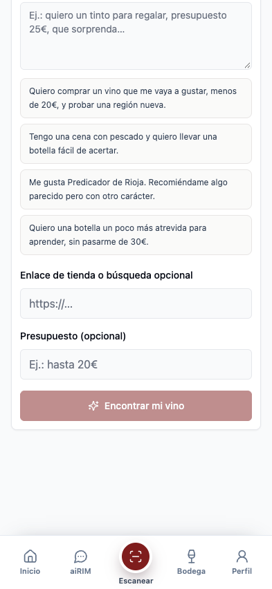
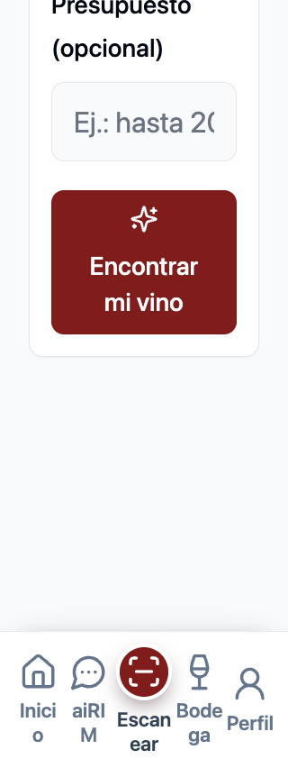

# Encontrar vino: complete examples and readable selection

Assignment `MATCHRIM-5H-20261011-10`. Baseline `b7de58bd2265628abc91a887ee32abb558068bdc`. This is a bounded local client checkpoint, not release or intelligence approval.

## Before / After / Why

| Before | After | Why |
| --- | --- | --- |
| Four visible/accessibility labels truncated at60 characters, but selecting inserted the entire sentence. | Complete original example appears in the button and accessible name, equal to the selected textarea value. | Users can inspect the actual request before choosing it. |
| Example targets42px and form inputs/CTA40px at base text size. | All measured form/example targets at least44px; examples use full-width, left-aligned wrapping rows. | More legible choices and consistent touch targets, without changing the phrases or handlers. |
| At320px/200% the selected route expanded to397px; CTA text escaped its own bounds. | Page remains320px; CTA wraps and is scroll-reachable above navigation. | Measured local min-content overflow required form padding/wrapping and a shop-link-only heading wrap. |
| Session, submit, history, label-save and result rendering already had08/09 contracts. | Six protected AST nodes byte-identical to baseline. | Do not rework previously validated behavior to repair presentation. |

## Controlled Matrix

Chrome Playwright, mobile/touch context and native Capacitor shim. Device scale factor1; root font scaled in CSS, not browser zoom or actual iOS Dynamic Type. Layout/visual viewport dimensions and scale captured. Anonymous isolated local storage; every nonlocal request intercepted before navigation. No submit/model invocation, real account, private URL, credential or remote request.

| Viewport / root text | Before | After | Page width before -> after | Example height after | CTA height after |
| --- | --- | --- | --- | --- | --- |
|393x852 /100% | FAIL | PASS |393 ->393 |58px |44px |
|320x852 /100% | FAIL | PASS |320 ->320 |58-78px |44px |
|320x852 /135% | FAIL | PASS |320 ->320 |104.59-131.59px |59.39px |
|320x852 /200% | FAIL | PASS |397 ->320 |314-354px |160px |
|852x393 /200% | FAIL | PASS |852 ->852 |114px |88px |

-20/20 complete visible text and exact accessible-name checks after; all20 were truncated before.
-80/80 click, touch, Enter and Space selections produce the exact full expected textarea value. These already passed before; this change fixes the visible/accessible mismatch, not selection logic.
- All measured example text ranges fit their own button. All measured form targets meet44px and horizontal containment.5/5 CTA center hit tests and bottom-navigation clearance pass after ordinary scroll.
- No page errors or nonlocal requests in either run. Only this route/form state is covered; no result generation was exercised.
- Pixel review: base393 examples, narrow320/200 examples and CTA, landscape852/200 CTA. Extreme text scaling creates tall choices requiring scrolling; no hidden words or reduced text size. The single-line budget placeholder clips at200% as an input placeholder, while its full explicit label remains visible. Navigation labels wrap at this extreme size; no claim of new navigation redesign or physical accessibility approval.

## Verification

- Typecheck PASS; lint PASS with0 errors and106 inherited warnings; web build PASS in6.47s with `VITE_MATCHRIM_QA_FIXTURES=false`. Existing chunk-size and outdated Browserslist warnings remain.
- `protected-contracts.json`: TypeScript AST extraction and byte comparison of EXAMPLES, useLayoutEffect lifetime, handleSubmit, result JSX, keyed exported shop wrapper, and Scan.handleExtractComplete. All6 unchanged. No rerun or replacement of08/09 matrices claimed.
- Product diff is limited to `WineShopLinkAdvisor.tsx` presentation and the conditional shop-link heading class in `Scan.tsx`. No changes to identity/classification/affinity algorithms in this checkpoint.
-27 evidence hashes and3 tested-source hashes. Previous01-09 artifacts/corpora/ledgers untouched.28 approved vision calls remain unused.

## Reproduce

From the repository, with the existing QA Python environment:

```bash
/Users/GOIKO/Documents/Codex/2026-07-26/tarea-recuperada-desde-anclados-nombre-original-8/artifacts/matchrim73-qa-20261007/.venv/bin/python /Users/GOIKO/.codex/skills/webapp-testing/scripts/with_server.py --server 'VITE_APP_ANALYTICS_ENABLED=false npm run dev -- --host 127.0.0.1 --port 4445' --port 4445 -- /Users/GOIKO/Documents/Codex/2026-07-26/tarea-recuperada-desde-anclados-nombre-original-8/artifacts/matchrim73-qa-20261007/.venv/bin/python scripts/qa-matchrim-shop-examples.py --output /tmp/matchrim-shop-examples-recheck
npm run typecheck
npm run lint
VITE_MATCHRIM_QA_FIXTURES=false npm run build
```

Baseline was measured before product edits using the same harness. Before evidence remains unchanged. Managed QA servers stopped after both runs.

## Evidence And Residual

Portable evidence: `docs/qa-evidence/matchrim-shop-examples-2026-10-11/` includes both raw results,20 screenshots,3 tool logs, protected contracts, tested sources and SHA256SUMS.





No native build/number change, Apple session, invitation, push, deployment, backend write or provider call. Previous unsigned80 does not include03-10 and is not a current combined candidate. Live recognition/canonical ground truth, human recommendation outcomes, hosted persistence, physical Dynamic Type/VoiceOver and release distribution remain separate gates. Requested tester invitation remains unsent; no claim otherwise. Stop at this completed scope.
